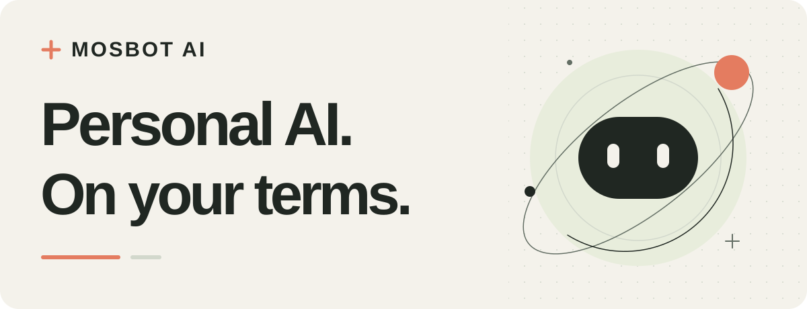

<picture>
  <source media="(prefers-color-scheme: dark)" srcset="https://raw.githubusercontent.com/MosBot-AI/.github/main/profile/assets/hero-dark.svg">
  <source media="(prefers-color-scheme: light)" srcset="https://raw.githubusercontent.com/MosBot-AI/.github/main/profile/assets/hero-light.svg">
  
</picture>

<strong>围绕你构建的开源个人 AI。</strong>

  <a href="https://github.com/MosBot-AI/.github/blob/main/profile/README.md">English</a> · 简体中文

  <a href="https://github.com/MosBot-AI/hermes-superagent">探索项目</a> ·
  <a href="https://github.com/MosBot-AI/hermes-superagent/blob/main/docs/README-zh.md">阅读设计</a> ·
  <a href="#一起参与">一起参与</a>

## 为真正重要的事，做一个个人助手

MosBot AI 是一个开源探索，目标是构建服务于工作与日常生活的个人 AI 助手。我们希望，你只需要面对一个懂得上下文、记得承诺、能持续推进事情的助手，并始终由你决定它的行动边界。

我们关心一次对话之后还需要继续的事：尚未完成的项目、答应过的事，以及值得迈出的下一步。

## 我们重视什么

### 01 / 事情能够接着做

围绕项目、承诺和有用的上下文设计。让进展、信息来源和尚未完成的工作保持清晰，让下一次对话能够接着上一次继续。

### 02 / 决定权在你手里

让权限具体、容易理解，为纠正、遗忘、撤销授权和自行部署留出空间。用户控制应当是架构的一部分，而不是事后补上的选项。

### 03 / 连接真正有用的工具

探索可扩展的助手，让它能够连接人们已经在用的工具。先明确插件与连接器的权限边界，再逐步拓展交互方式，包括语音。

## 从这里开始

### [Hermes Personal Agent ↗](https://github.com/MosBot-AI/hermes-superagent)

我们的公开项目探索一个 Hermes 原生个人 Agent：由一个主助手统筹项目、承诺、提醒，以及权限受限的工作代理。

**当前阶段：设计文档与早期开发。** 默认的 `main` 分支目前仅发布文档，实验性实现保留在开发分支。完整 MVP 尚未实现，受控写入仍未通过发布门槛，也未宣称已经生产部署。

- [产品目标与范围](https://github.com/MosBot-AI/hermes-superagent/blob/main/docs/01-product-and-scope-zh.md)
- [架构设计](https://github.com/MosBot-AI/hermes-superagent/blob/main/docs/03-native-architecture-zh.md)
- [路线图与验收标准](https://github.com/MosBot-AI/hermes-superagent/blob/main/docs/08-roadmap-and-acceptance-zh.md)
- [当前状态与开发证据](https://github.com/MosBot-AI/hermes-superagent/blob/main/README-zh.md)

## 我们想走向哪里

**用真实完成的事情，赢得信任的个人助手。**

我们的路线是从可靠、权限清晰的基础开始，逐步走向长期的个人上下文、持续跟进、工具连接，以及更自然的交互。

1. **把基础做扎实。** 明确身份与权限，让行动可追溯，在工作中断后能够恢复。
2. **让事情持续推进。** 围绕项目、承诺、提醒和跟进，提供可见的状态与完成证据。
3. **融入日常使用方式。** 在同一套用户控制机制之上，逐步接入有明确权限范围的连接器、消息入口和语音。

这些是我们正在努力的方向，不是今天已经可用的功能清单。我们更愿意一步一步验证，而不是提前承诺。

## 一起参与

项目仍处于早期，欢迎一起塑造它的方向。无论你是开发者、设计师、研究者、文档作者，还是有一个希望个人助手帮忙解决的实际问题，都可以参与。

- **带来真实需求。** 描述你愿意交给助手的任务，以及哪些步骤需要先问过你。
- **检验设计。** 帮我们发现权限边界、记忆行为、中断恢复和日常体验中的问题。
- **让项目更易懂。** 改进文档、翻译、示例，以及新贡献者的入门路径。
- **贡献代码。** 先了解当前状态与路线图，较大的实现建议先沟通范围。

**[分享想法或反馈问题 →](https://github.com/MosBot-AI/hermes-superagent/issues)**

提交前请先查看已有 Issues。公开报告请使用模拟示例，并删除凭据和个人信息。

关注 [MosBot AI](https://github.com/MosBot-AI)，或为[项目点一颗 Star](https://github.com/MosBot-AI/hermes-superagent)，了解后续进展。

---

<strong>开放构建，以人为本。</strong> 为你而建，由你掌控。

