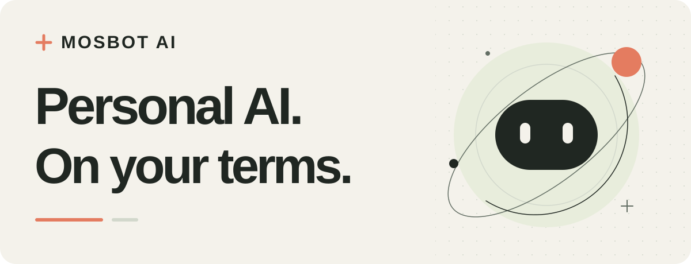

<picture>
  <source media="(prefers-color-scheme: dark)" srcset="https://raw.githubusercontent.com/MosBot-AI/.github/main/profile/assets/hero-dark.svg">
  <source media="(prefers-color-scheme: light)" srcset="https://raw.githubusercontent.com/MosBot-AI/.github/main/profile/assets/hero-light.svg">
  
</picture>

<strong>Open-source personal AI, built around you.</strong>

  English · <a href="https://github.com/MosBot-AI/.github/blob/main/profile/README-zh.md">简体中文</a>

  <a href="https://github.com/MosBot-AI/hermes-superagent">Explore the project</a> ·
  <a href="https://github.com/MosBot-AI/hermes-superagent/blob/main/docs/README.md">Read the design</a> ·
  <a href="#build-with-us">Build with us</a>

## An assistant for the things that matter

MosBot AI is an open-source initiative building toward a personal AI assistant for work and everyday life. Our vision is one assistant that understands the context, keeps track of commitments, and helps move things forward within the boundaries you choose.

We care about the work that continues after a conversation: the project to finish, the promise to remember, and the next step worth taking.

## What guides our work

### 01 / Continuity

Design around projects, commitments, and useful context. Make progress, sources, and unfinished work visible, so the next conversation can pick up where the last one left off.

### 02 / Your control

Keep permissions specific and understandable. Make room for correction, forgetting, revocation, and self-hosting. Treat user control as part of the architecture, not an afterthought.

### 03 / Connections that help

Work toward an extensible assistant that can connect to the tools people already use. Start with clear boundaries for plugins and connectors, then expand the ways people can interact, including voice.

## Start here

### [Hermes Personal Agent ↗](https://github.com/MosBot-AI/hermes-superagent)

Our public project explores a Hermes-native personal agent: one main assistant coordinating projects, commitments, reminders, and narrowly scoped workers.

**Current stage: design documents and early development.** The default `main` branch publishes documentation only. Experimental implementation lives on a development branch. The full MVP is not implemented, controlled writes remain blocked, and no production deployment is claimed.

- [Product goals & scope](https://github.com/MosBot-AI/hermes-superagent/blob/main/docs/01-product-and-scope.md)
- [Architecture](https://github.com/MosBot-AI/hermes-superagent/blob/main/docs/03-native-architecture.md)
- [Roadmap & acceptance criteria](https://github.com/MosBot-AI/hermes-superagent/blob/main/docs/08-roadmap-and-acceptance.md)
- [Current status & development evidence](https://github.com/MosBot-AI/hermes-superagent#current-status-on-main)

## Where we want to go

**A dependable personal assistant that earns trust through what it actually does.**

Our roadmap moves from a reliable, permission-aware foundation toward long-lived personal context, useful follow-through, connected tools, and more natural interaction.

1. **Get the foundations right.** Identity, clear permissions, traceable actions, and recovery when work is interrupted.
2. **Carry the work forward.** Projects, commitments, reminders, and follow-ups with visible state and evidence.
3. **Meet people where they are.** Carefully scoped connectors, messaging, and voice, built on the same user-controlled foundation.

These are directions we are working toward, not a list of features available today. We prefer small, verifiable steps to promises without evidence.

## Build with us

We are early, and there is room to shape what comes next. Developers, designers, researchers, writers, and people with a real problem for a personal assistant to solve are welcome.

- **Bring a use case.** Describe a task you would actually trust an assistant with, and where you would want it to ask first.
- **Question the design.** Help us find gaps in permission boundaries, memory behavior, recovery, and everyday usability.
- **Make it clearer.** Improve documentation, translations, examples, and the path for new contributors.
- **Contribute code.** Start with the project status and roadmap, then discuss the scope of a change before a larger implementation.

**[Share an idea or report a problem →](https://github.com/MosBot-AI/hermes-superagent/issues)**

Read the existing issues before opening one. Please use synthetic examples and remove credentials and personal information from public reports.

Follow [MosBot AI](https://github.com/MosBot-AI) or star [the project](https://github.com/MosBot-AI/hermes-superagent) to stay close to the work.

---

<strong>Built in the open. Shaped around people.</strong> Personal AI. On your terms.

